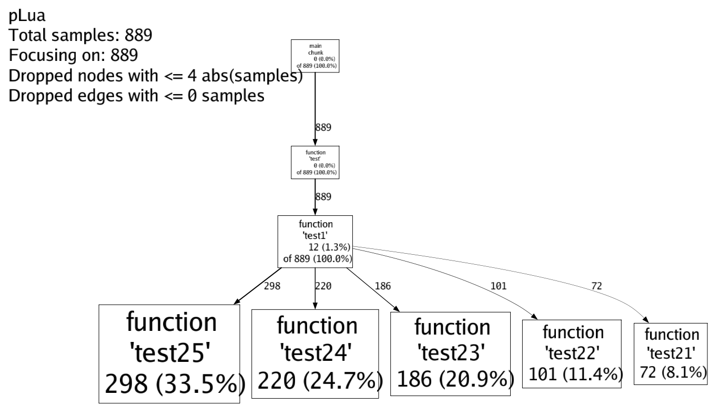
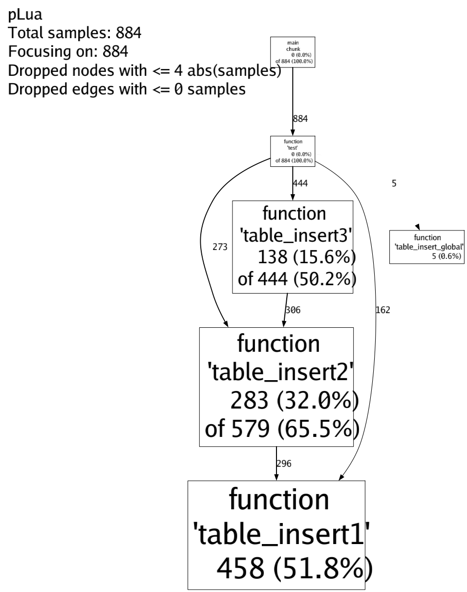

# pLua

[English](README.md) | [中文文档](README_CN.md)

[](https://github.com/esrrhs/pLua)
[](https://github.com/esrrhs/pLua)
[](https://github.com/esrrhs/pLua/actions)

Lua Performance Profiler & Memory Profiler.

## Overview

Similar to `gperftools`, **pLua** profiles CPU hotspots and memory allocations for Lua programs. Embed it as a shared library, collect `.pro` profiles, then convert them with `tools/plua` for [FlameGraph](https://github.com/brendangregg/FlameGraph) SVGs or `pprof`-compatible call graphs.

> Chinese documentation: [README_CN.md](README_CN.md)

## Features

- **Easy to use**: A few lines of Lua to start/stop profiling. On **Linux** you can also inject into a running process via [hookso](https://github.com/esrrhs/hookso) without modifying code.
- **CPU attribution**: POSIX uses `ITIMER_PROF` / `SIGPROF` ticks and safe-context Lua stack snapshots, including CPU-bound C calls. Windows (or forced fallback) samples VM instruction counts, **not C CPU time**. See precision limits below.
- **Multi-state**: Each `lua_State` has its own profiler session. You can profile several states in one process. **Multi-state is not multi-OS-thread safe** — keep profiling on one OS thread; see the process-CPU caveat below.
- **Independent CPU / Memory**: CPU and memory profiling use separate running flags; both can run at the same time on one state.
- **Configurable rates**: `set_config` / `get_config`, environment variables, and optional rate arguments on `start` / `start_mem`.
- **Runtime status**: `status()` reports whether CPU/mem are running, sample counts, output paths, backend, and a config snapshot. `close()` tears down the session for the current `lua_State`.
- **Configurable overhead**: Sampling frequency is tunable; call/return stack snapshots add workload-dependent overhead.
- **Lua attribution through C**: Safe-boundary snapshots skip C frames (inspired by [vLua](https://github.com/esrrhs/vLua)) and retain the nearest Lua frames (existing source/name/function-definition information). This is **not** a full native C unwind — only Lua call info is recovered.
- **Intuitive**: Outputs call graphs compatible with `pprof` (`gperftools`) and FlameGraph collapsed stacks / SVGs.

---

## Platforms

| Platform | Library artifact | CPU backend | hookso injection | Notes |
|----------|------------------|-------------|------------------|-------|
| Linux    | `bin/libplua.so` | `SIGPROF` (default) or `LUA_MASKCOUNT` | Supported | Primary platform |
| macOS    | `bin/libplua.so` (also loadable as `.dylib` via cpath) | `SIGPROF` (default) or count | **Not supported** | Embedding OK |
| Windows  | `bin/libplua.dll` | `LUA_MASKCOUNT` | **Not supported** | Embedding OK |

### Lua version support

pLua targets **Lua 5.2 / 5.3 / 5.4** (uses `luaL_newlib` / `luaL_checkversion` / `luaL_requiref`).

**Lua 5.1 and LuaJIT are not supported** by the current module loader API.

---

## Dependencies & Installation

### Ubuntu / Debian

```shell
sudo apt-get update
sudo apt-get install -y lua5.3 liblua5.3-dev
```

### CentOS / RHEL / Fedora

```shell
sudo yum install -y lua-devel
```

### macOS (Homebrew)

```shell
brew install lua
```

### Windows

Install Lua 5.4 development headers/libs (vcpkg, Chocolatey, or a manual build), then point CMake at them via `LUA_INCLUDE_DIR` / `LUA_LIBRARIES` if needed.

---

## Build

```shell
mkdir build && cd build
cmake .. -DCMAKE_BUILD_TYPE=Release
cmake --build .
```

Artifacts land in `bin/`:

- Linux / macOS: `libplua.so`
- Windows: `libplua.dll`
- If Go is available: `plua` profile converter (`tools/plua.go`)

---

## Unit Testing

```shell
cd build
ctest --output-on-failure
```

Or run the Lua unit test directly (after build):

```shell
cd test
lua test_unit.lua
```

Multi-`lua_State` coverage is in the C++ harness (`unit_test` / `unit_test --multistate`).

---

## Usage

### Module name

```lua
local p = require "libplua"   -- preferred (matches libplua.so / .dll)
-- If you ship a copy/symlink named plua.so, require "plua" also works (luaopen_plua).
```

Add the library directory to `package.cpath` as needed:

```lua
package.cpath = "./bin/?.so;./bin/?.dylib;./bin/?.dll;" .. package.cpath
```

### 1. Collect CPU profile data

#### Embed in Lua code

```lua
local p = require "libplua"

-- Arg 1: sampling duration in seconds (0 = until stopped)
-- Arg 2: output profile file path
-- Arg 3 (optional): CPU sample interval in milliseconds
--                   (updates global default; else PLUA_CPU_INTERVAL_MS / 10)
p.start(0, "call.pro")
-- p.start(0, "call.pro", 5)

do_some_thing()

p.stop()
```

#### Inject via [hookso](https://github.com/esrrhs/hookso) (**Linux only**)

```shell
# a) Obtain a lua_State* in the target process
./hookso arg $PID xxx.so lua_settop 1
# -> prints L, e.g. 123456

# b) Load libplua.so
./hookso dlopen $PID ./libplua.so

# c) Start CPU profiling: lrealstart(L, seconds, path)
./hookso call $PID libplua.so lrealstart i=123456 i=0 s="./call.pro"

# d) Stop CPU profiling
./hookso call $PID libplua.so lrealstop i=123456
```

hookso injection is **not supported on macOS or Windows** — use embedding there.

---

### 2. Collect memory profile data

#### Embed in Lua code

```lua
local p = require "libplua"

-- Arg 1: max samples (0 = until stopped)
-- Arg 2: output prefix -> <prefix>_ALLOC_SIZE.pro and <prefix>_USAGE.pro
-- Arg 3 (optional): sampling rate in bytes
--                   (updates global default; else PLUA_MEM_RATE / 524288)
p.start_mem(0, "mem.pro")
-- p.start_mem(0, "mem.pro", 262144)

do_some_thing()
collectgarbage("collect")  -- optional, for retained-memory (_USAGE) view
p.stop_mem()
```

#### Inject via hookso (**Linux only**)

```shell
./hookso arg $PID xxx.so lua_settop 1
./hookso dlopen $PID ./libplua.so
./hookso call $PID libplua.so lrealstartmem i=123456 i=0 s="./mem.pro"
./hookso call $PID libplua.so lrealstopmem i=123456
```

---

### 3. Multi `lua_State`

Each state keeps an independent session (CPU and/or mem). Stopping one state does not stop others.

```lua
-- In host C/C++: create L1, L2, require libplua in each, call start/stop per state.
```

**Thread safety:** use one OS thread for all pLua/Lua activity. Sessions and attribution snapshots are not thread-safe. The POSIX timer measures **process** CPU: other CPU-active native threads can contaminate attribution even if Lua access is externally locked. All concurrent SIGPROF sessions must use the same interval; conflicting starts return an error.

---

### 4. Hook exclusivity & coroutine boundaries

**`lua_sethook` exclusivity.** pLua installs its own debug hook via `lua_sethook` for CPU sampling (and briefly when arming mem samples). It expects **exclusive** ownership of the hook on that `lua_State` while profiling:

- Do **not** run another debugger / profiler / coverage tool that also calls `lua_sethook` on the same state at the same time — they will overwrite each other and produce wrong or missing samples (or break the other tool).
- Stop pLua (`stop` / `stop_mem` / `close`) before attaching a different hook-based tool.

**Coroutines.** Lua 5.2–5.4 may copy debug hooks to newly created threads, but that does **not** create a pLua session. Explicitly call `start` / `stop` inside every coroutine you want to profile. Enrolled coroutines are kept alive until stop/close or global `lua_close`.

- Unenrolled coroutines created **after** profiling starts inherit boundary hooks on supported Lua versions; their CPU ticks are excluded, including across repeated yield/resume.
- **Pre-existing/unhooked coroutines and uninstrumented Lua states entered from C cannot be detected by the public API.** Time there may be charged to the enclosing Lua caller of `coroutine.resume` / the C bridge. Enroll them explicitly or exclude such workloads when interpreting the parent profile.
- Tail calls erase callers in Lua's debug stack: pLua does not invent those missing frames.

Session cleanup: stop/close unregisters only that session; per-thread registry anchors also clean up active sessions on global `lua_close`. Stopping one coroutine does not invalidate another's anchor.

**C-time precision (POSIX).** Call, return and count hooks snapshot recoverable Lua/main frames, skipping C frames, in a normal VM context. The signal handler only increments a lock-free counter: **no Lua APIs, allocations, locks, session-map iteration, or native unwinding**. At the next boundary, all delivered ticks are charged to the **previous** snapshot before installing the new one. Thus a long C call retains multiple ticks and bills its Lua caller, not unrelated Lua work after its return; Lua→C→Lua callbacks update attribution at entry/return. A direct C `lrealstop(L)` also drains pending ticks and flushes; call it only on the VM thread in a safe context, never from a signal handler.

This is not an exact interrupted-stack sampler like vLua's VM-internal approach: snapshots can be stale between hooks, error unwinds/continuations can skip return hooks, and hook execution itself adds overhead (especially call-heavy/deep-stack code). POSIX signals can coalesce **in the kernel**, and blocked/delayed signals cannot be reconstructed. Pure C with no recoverable Lua frame is excluded. Host CPU between observed VM exits/entries is excluded when no owner exists, but unobserved transitions have the limits above. pLua owns `SIGPROF` / `ITIMER_PROF`; do not combine it with another user of them. Profiles estimate CPU time as delivered ticks × configured interval, not exact elapsed time. Count backend samples only Lua VM instructions and cannot measure time spent in C.

---

### 5. Runtime status

```lua
local st = p.status()
-- st.cpu_running / st.mem_running  (boolean)
-- st.cpu_samples / st.mem_samples  (number, samples collected so far)
-- st.cpu_output / st.mem_output    (path or nil)
-- st.cpu_backend                   ("sigprof" or "count")
-- st.config                        (same shape as get_config())

p.close()  -- stop cpu+mem if needed and free the session for this state
```

On start failure, `start` / `start_mem` return `-1` plus an error string as the second result (e.g. already running, missing path).

---

### 6. Configurable sample rates

Lua API:

```lua
p.set_config({
  cpu_interval_ms = 10,   -- SIGPROF interval (POSIX)
  cpu_hook_count = 1000,  -- LUA_MASKCOUNT step (Windows / fallback)
  mem_rate = 524288,      -- bytes between mem samples
  cpu_backend = "sigprof" -- or "count" / "maskcount"
})

local cfg = p.get_config()
print(cfg.cpu_backend, cfg.cpu_interval_ms, cfg.cpu_hook_count, cfg.mem_rate)
```

Environment variables (read once at first use of start / config APIs):

| Variable | Meaning | Default |
|----------|---------|---------|
| `PLUA_CPU_INTERVAL_MS` | POSIX timer interval (ms) | `10` |
| `PLUA_CPU_HOOK_COUNT` | `LUA_MASKCOUNT` instructions per sample | `1000` |
| `PLUA_MEM_RATE` | Memory sampling period (bytes) | `524288` |
| `PLUA_CPU_BACKEND` | `sigprof` or `count` / `maskcount` | `sigprof` on POSIX, always `count` on Windows |

---

## `.pro` file format (CPU v2, memory v1)

All integers in the existing little-endian format are 32-bit. CPU v2 starts with six `uint32` words: magic `0x41554C50` (`PLUA`), version `2`, kind `1` (CPU), backend `1` (SIGPROF) / `2` (count), interval in ms, and nominal VM hook instruction step. This metadata prevents guessing CPU units from filenames. Memory output remains v1 (magic + version `1`); v0 has no header.

The payload is unchanged: records contain count/weight, depth and 64 root-first frame IDs; the trailing string table contains `(name bytes, byte length, ID)` entries followed by entry count. Empty CPU profiles have a valid trailing table. SIGPROF weights count delivered ticks, count weights count hook samples, and memory weights are sampled allocation bytes / estimated live bytes. `tools/plua` reads v0/v1/v2, rejects unknown versions and malformed/truncated records. Old converters must be updated to read v2.

---

## Visualization & Tools

### `tools/plua`

Go converter (built to `bin/plua` when Go is available):

```shell
# FlameGraph collapsed stacks
./bin/plua -i call.pro -flame call.fl

# Legacy gperftools symbolized profile (-pprof remains unchanged)
./bin/plua -i call.pro -pprof call.prof

# Modern gzip profile.proto (CPU v2 only, no third-party Go dependencies)
./bin/plua -i call.pro -proto call.pb.gz
go tool pprof -top call.pb.gz
go tool pprof -sample_index=samples -top call.pb.gz

# Multiple outputs
./bin/plua -i call.pro -flame call.fl -proto call.pb.gz -pprof call.prof
```

`-collapsed` is an alias for `-flame`. `-proto` emits leaf-first stacks with valid function/location IDs and string-table index 0 empty. SIGPROF exports `samples/count` plus estimated `cpu/nanoseconds`, a CPU period, and count × interval weights. Count backend exports only `samples/count`, with nominal `instructions/count` period—never fabricated CPU nanoseconds. Simultaneous memory profiling can shorten some count-hook intervals. No timestamps/duration are invented.

`-proto` deliberately rejects memory and legacy/v1 files: those lack reliable type/backend/period metadata. Keep using `-flame` / legacy `-pprof` for these; memory values must be interpreted as bytes, not CPU samples/time. Existing `show.sh` continues to use legacy output.

### Precision and converter tests

```shell
cmake -S . -B build -DBUILD_TESTING=ON
cmake --build build -j2
ctest --test-dir build --output-on-failure
(cd tools && go test ./... -v)
# Optional statistical experiment; NOT a timing threshold in CI:
./bin/precision_test --experiment
```

The deterministic suite injects delivered SIGPROF ticks and checks exact weights/leaf attribution: long C-boundary batches, C→Lua callbacks, pending-stop drain, erased tail callers, repeated coroutine resume, global close/restart and independent states. Windows runs count-backend checks only. Converter tests check metadata, units, stack order, IDs, truncation/malformed input, legacy/flame output, and invoke real `go tool pprof -top` on generated CPU/count fixtures. The optional experiment burns 600ms of C CPU and reports nominal 60-tick bias without flaky statistical assertions.

### Prerequisites (optional)

- **FlameGraph**: `show.sh` fetches `flamegraph.pl` if needed
- **Graphviz**: for call graph PNG (`dot`)
- **pprof**: `go install github.com/google/pprof@latest`

### Batch generate visualizations

```shell
cd tools
./show.sh ../test
```

Outputs per `.pro`: `.fl` (collapsed), `.svg` (flamegraph), `.prof` (pprof), and optionally `.dot` / `.png` call graphs.

---

## Examples

### CPU FlameGraph & Call Graph



### Memory Allocation Graph



---

## Related Projects

- [lua-family-bucket](https://github.com/esrrhs/lua-family-bucket)
- [hookso](https://github.com/esrrhs/hookso) (Linux process injection helper)
