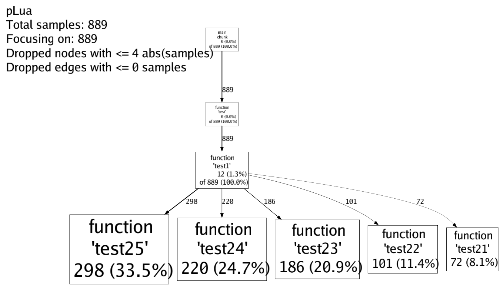
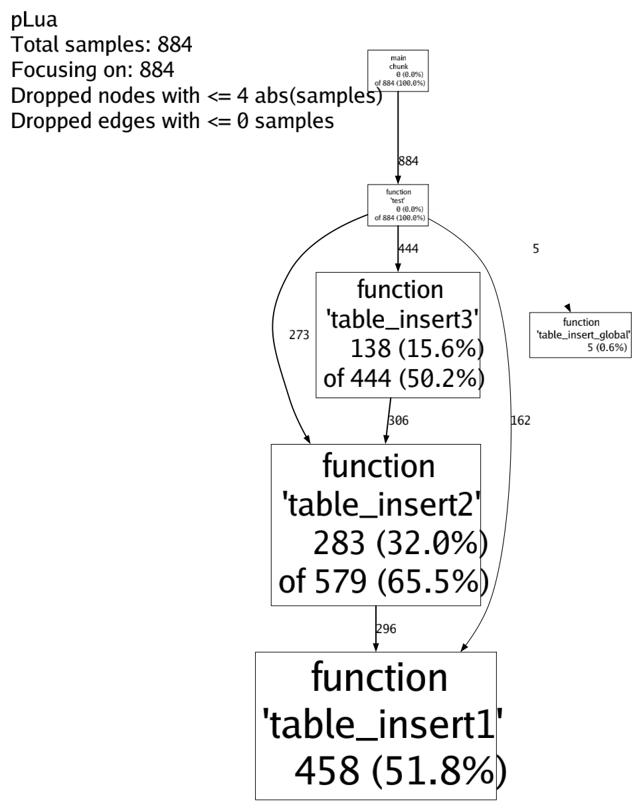

# pLua

[English](README.md) | [中文文档](README_CN.md)

[](https://github.com/esrrhs/pLua)
[](https://github.com/esrrhs/pLua)
[](https://github.com/esrrhs/pLua/actions)

Lua 性能及内存分析工具。

## 简介

类似于 `gperftools`，**pLua** 可以分析 Lua 程序的 CPU 热点与内存分配。以共享库方式嵌入，采集 `.pro` 采样文件，再用 `tools/plua` 转换为 [火焰图](https://github.com/brendangregg/FlameGraph) SVG 或兼容 `pprof` 的调用图。

> 主文档（English）：[README.md](README.md)

## 特性

- **简单**：只需几行 Lua 即可启停采样。在 **Linux** 上还可通过 [hookso](https://github.com/esrrhs/hookso) 动态注入运行中的进程，无需改业务代码。
- **准确**：POSIX 默认使用周期性定时采样（`ITIMER_PROF` / `SIGPROF`），更能捕获执行热点，并自动剔除 sleep 等空闲时间。Windows（或通过配置强制）回退到 `LUA_MASKCOUNT`。
- **多 State**：每个 `lua_State` 拥有独立会话，可在同一进程中对多个 State 分别采样。**多 State ≠ 多 OS 线程安全**——不要在未加同步的情况下从多个 OS 线程并发调用 pLua。
- **CPU / 内存独立开关**：`cpuRunning` / `memRunning` 分离，同一 State 上可同时开启。
- **可配置采样率**：`set_config` / `get_config`、环境变量，以及 `start` / `start_mem` 的可选速率参数。
- **运行时状态查询**：`status()` 可查看 CPU/内存是否在采、样本数、输出路径、当前后端与配置快照；`close()` 用于释放当前 `lua_State` 上的会话。
- **轻量**：基于采样，对宿主性能影响小。
- **C 回调仍可归因到 Lua**：采样落在 C API / C 回调栈帧上时，会跳过 C 帧（思路对齐 [vLua](https://github.com/esrrhs/vLua)），保留最近的 Lua 帧（源文件/函数名/行号）。这不是完整的原生 C 栈展开，只恢复 Lua 侧信息。
- **直观**：兼容 `pprof`（`gperftools`），可生成折叠堆栈与火焰图 SVG。

---

## 平台

| 平台 | 产物 | CPU 后端 | hookso 注入 | 说明 |
|------|------|----------|-------------|------|
| Linux | `bin/libplua.so` | `SIGPROF`（默认）或 `LUA_MASKCOUNT` | 支持 | 主平台 |
| macOS | `bin/libplua.so`（也可通过 cpath 以 `.dylib` 加载） | `SIGPROF`（默认）或 count | **不支持** | 嵌入可用 |
| Windows | `bin/libplua.dll` | `LUA_MASKCOUNT` | **不支持** | 嵌入可用 |

### Lua 版本

支持 **Lua 5.2 / 5.3 / 5.4**（依赖 `luaL_newlib` / `luaL_checkversion` / `luaL_requiref`）。

当前模块加载 API **不支持 Lua 5.1 / LuaJIT**（旧文档中的兼容声明不准确）。

---

## 依赖安装

### Ubuntu / Debian

```shell
sudo apt-get update
sudo apt-get install -y lua5.3 liblua5.3-dev
```

### CentOS / RHEL / Fedora

```shell
sudo yum install -y lua-devel
```

### macOS (Homebrew)

```shell
brew install lua
```

### Windows

安装 Lua 5.4 开发头文件与库（vcpkg、Chocolatey 或自行编译），必要时通过 `LUA_INCLUDE_DIR` / `LUA_LIBRARIES` 告知 CMake。

---

## 编译构建

```shell
mkdir build && cd build
cmake .. -DCMAKE_BUILD_TYPE=Release
cmake --build .
```

产物位于 `bin/`：

- Linux / macOS：`libplua.so`
- Windows：`libplua.dll`
- 若已安装 Go：会额外编译 `plua` 转换工具（`tools/plua.go`）

---

## 单元测试

```shell
cd build
ctest --output-on-failure
```

或直接运行 Lua 单元测试（需先完成构建）：

```shell
cd test
lua test_unit.lua
```

多 `lua_State` 场景由 C++ 测试覆盖（`unit_test` / `unit_test --multistate`）。

---

## 使用说明

### 模块名

```lua
local p = require "libplua"   -- 推荐（与 libplua.so / .dll 对应）
-- 若将库命名/软链为 plua.so，也可 require "plua"（提供 luaopen_plua 别名）
```

按需把库目录加入 `package.cpath`：

```lua
package.cpath = "./bin/?.so;./bin/?.dylib;./bin/?.dll;" .. package.cpath
```

### 1. 获取 CPU 采样数据

#### 方式一：在 Lua 中嵌入

```lua
local p = require "libplua"

-- 参数 1：采样时长（秒），0 表示一直采样直到显式停止
-- 参数 2：输出 .pro 文件路径
-- 参数 3（可选）：CPU 采样间隔毫秒（会更新全局默认；否则用 PLUA_CPU_INTERVAL_MS / 10）
p.start(0, "call.pro")
-- p.start(0, "call.pro", 5)

do_some_thing()

p.stop()
```

#### 方式二：使用 [hookso](https://github.com/esrrhs/hookso) 注入（**仅 Linux**）

```shell
# a) 获取目标进程中的 lua_State 指针
./hookso arg $PID xxx.so lua_settop 1
# -> 例如输出 123456

# b) 加载 libplua.so
./hookso dlopen $PID ./libplua.so

# c) 开启 CPU 采样：lrealstart(L, seconds, path)
./hookso call $PID libplua.so lrealstart i=123456 i=0 s="./call.pro"

# d) 结束 CPU 采样
./hookso call $PID libplua.so lrealstop i=123456
```

macOS / Windows **不支持** hookso 注入，请使用嵌入方式。

---

### 2. 获取内存采样数据

#### 方式一：在 Lua 中嵌入

```lua
local p = require "libplua"

-- 参数 1：最大采样次数（0 表示一直采样直到停止）
-- 参数 2：输出文件名前缀，生成 <prefix>_ALLOC_SIZE.pro 与 <prefix>_USAGE.pro
-- 参数 3（可选）：采样字节率（会更新全局默认；否则用 PLUA_MEM_RATE / 524288）
p.start_mem(0, "mem.pro")
-- p.start_mem(0, "mem.pro", 262144)

do_some_thing()
collectgarbage("collect")  -- 可选，便于观察常驻内存（_USAGE）
p.stop_mem()
```

#### 方式二：使用 hookso 注入（**仅 Linux**）

```shell
./hookso arg $PID xxx.so lua_settop 1
./hookso dlopen $PID ./libplua.so
./hookso call $PID libplua.so lrealstartmem i=123456 i=0 s="./mem.pro"
./hookso call $PID libplua.so lrealstopmem i=123456
```

---

### 3. 多 `lua_State`

每个 State 维护独立会话（CPU 与/或内存）。停止其中一个不会影响其他 State。

```lua
-- 在宿主 C/C++ 中：创建 L1、L2，分别 require libplua，再按 State 调用 start/stop。
```

**线程安全：** 多个 `lua_State` 从 **同一 OS 线程** 使用是安全的（或自行加锁）。**不要**在没有外部同步的情况下从两个 OS 线程分别驱动两个 State。

---

### 4. Hook 独占与协程边界

**`lua_sethook` 独占。** pLua 通过 `lua_sethook` 安装调试钩子做 CPU 采样（内存采样武装时也会短暂使用）。在某个 `lua_State` 上采样期间，它假定 **独占** 该 State 的 hook：

- **不要**在同一 State 上同时运行其它也会调用 `lua_sethook` 的调试器 / 分析器 / 覆盖率工具——彼此会互相覆盖，导致采样缺失或对方工具失效。
- 在接入其它基于 hook 的工具之前，请先 `stop` / `stop_mem` / `close` 停止 pLua。

**协程。** `coroutine.create`（及相关 API）会创建 **新的** Lua thread，共享全局状态但 **不会继承** 父线程的 debug hook。子协程 **不会** 自动被采样：

- 对每个需要分析的协程 / `lua_State` 分别调用 `start` / `start_mem`，**或者**
- 解读结果时，只把采样范围理解为「你显式 start 过的那些线程」。

会话回收：CPU 与内存都停止后（或调用 `close`）会注销会话；`lua_close` 时也会通过 registry userdata 的 `__gc` 清理，避免 `gSessions` 残留悬空指针。

**C 栈帧。** 当采样发生在 C 函数中（标准库、`lua_CFunction`，或栈上仍有 C→Lua 回调）时，会 **跳过** 这些 C 帧，归因到可恢复的顶层 Lua 帧。pLua 本身不做原生 C 符号回溯；如需完整 native 栈，请配合外部原生分析器。

---

### 5. 运行时状态

```lua
local st = p.status()
-- st.cpu_running / st.mem_running  (boolean)
-- st.cpu_samples / st.mem_samples  (number，当前已采样本数)
-- st.cpu_output / st.mem_output    (路径或 nil)
-- st.cpu_backend                   ("sigprof" 或 "count")
-- st.config                        (与 get_config() 同结构)

p.close()  -- 如有需要会先 stop cpu/mem，并释放本 State 上的会话
```

`start` / `start_mem` 失败时返回 `-1`，并在第二个返回值给出错误说明（例如已在运行、缺少输出路径）。

---

### 6. 可配置采样率

Lua API：

```lua
p.set_config({
  cpu_interval_ms = 10,   -- SIGPROF 间隔（POSIX）
  cpu_hook_count = 1000,  -- LUA_MASKCOUNT 步长（Windows / 回退）
  mem_rate = 524288,      -- 内存采样字节周期
  cpu_backend = "sigprof" -- 或 "count" / "maskcount"
})

local cfg = p.get_config()
print(cfg.cpu_backend, cfg.cpu_interval_ms, cfg.cpu_hook_count, cfg.mem_rate)
```

环境变量（在首次调用 start / config API 时读取一次）：

| 变量 | 含义 | 默认 |
|------|------|------|
| `PLUA_CPU_INTERVAL_MS` | POSIX 定时器间隔（毫秒） | `10` |
| `PLUA_CPU_HOOK_COUNT` | `LUA_MASKCOUNT` 每样本指令数 | `1000` |
| `PLUA_MEM_RATE` | 内存采样周期（字节） | `524288` |
| `PLUA_CPU_BACKEND` | `sigprof` 或 `count` / `maskcount` | POSIX 默认 `sigprof`，Windows 固定为 `count` |

---

## `.pro` 文件格式（v1）

带版本的采样文件以如下头部开头：

- magic `PLUA`（4 字节，小端 `0x41554C50`）
- version `uint32` LE（当前为 `1`）
- 随后为兼容旧版的负载（调用栈 + 尾部字符串表）

`tools/plua` 同时接受 v1（有头）与旧格式（无头，视为 version 0）。

---

## 可视化与工具

### `tools/plua`

Go 转换工具（安装了 Go 时会编译到 `bin/plua`）：

```shell
# 火焰图折叠堆栈
./bin/plua -i call.pro -flame call.fl

# pprof 符号化 profile
./bin/plua -i call.pro -pprof call.prof

# 同时生成
./bin/plua -i call.pro -flame call.fl -pprof call.prof
```

`-collapsed` 是 `-flame` 的别名。

### 可选依赖

- **FlameGraph**：若本地没有 `flamegraph.pl`，`show.sh` 会尝试自动下载
- **Graphviz**：用于调用图 PNG（`dot`）
- **pprof**：`go install github.com/google/pprof@latest`

### 批量生成可视化

```shell
cd tools
./show.sh ../test
```

每个 `.pro` 可产出：`.fl`（折叠堆栈）、`.svg`（火焰图）、`.prof`（pprof），以及可选的 `.dot` / `.png` 调用图。

---

## 示例

### CPU 火焰图与调用图



### 内存分配图



---

## 相关项目

- [lua-family-bucket](https://github.com/esrrhs/lua-family-bucket)
- [hookso](https://github.com/esrrhs/hookso)（Linux 进程注入辅助工具）
